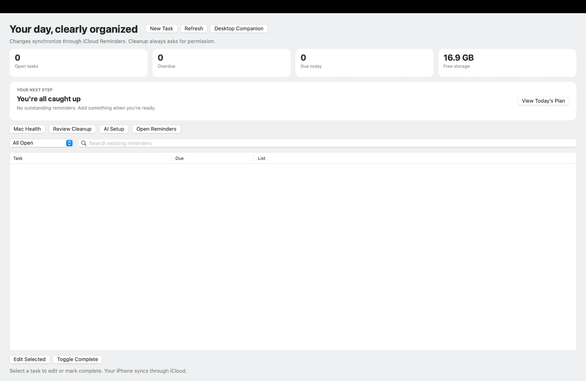

# Mac AI Productivity Hub

A native macOS menu-bar and desktop app that turns Apple Reminders into a focused task dashboard. It also includes a set of Python command-line tools for daily planning, Mac health checks and careful storage cleanup.

Everything runs on your Mac. Tasks live in your existing iCloud Reminders, so changes made in the Hub show up on your iPhone and the other way round. There's no separate database and no account. The app itself makes no network calls. AI features go through a Shortcut you set up yourself, and you choose its model.

    



## Features

**Native app (Swift + AppKit + EventKit)**

- **Dashboard** with overview cards for open tasks, overdue tasks, tasks due today and free storage. A "Your next step" card points out the most urgent task.
- **Task list** with views for All Open, Today, Overdue, Upcoming, No Due Date and Completed, sorted by due date and time.
- **Add and edit reminders** with Apple's native date/time picker and quick buttons for Today, Tomorrow and Next Week. You can choose any of your Reminders lists.
- **Complete, search and snooze** reminders (+1 day or +1 week).
- **Menu-bar icon** that shows live counts of open and overdue tasks.
- **Today's Plan**: a date-sorted plan of your open tasks. If you set up an Apple Intelligence Shortcut, it can generate a written plan instead, but only after asking before it sends your task titles.
- **Desktop Companion**: a small floating panel with your counts, your next task and quick actions.
- **Review Cleanup**: lists app caches, old screenshots and installers, unfinished downloads, unused VS Code extensions and `node_modules` in idle projects, all unchecked. It also shows large apps, chat app data, iCloud leftovers and duplicate project copies with advice, but never removes those. Anything you pick goes to the Trash after a second confirmation. Nothing is permanently deleted.
- **Mac Health**: a plain-language report on free space, memory, swap and the apps using the most memory.
- **Duplicate protection**: it won't create a second incomplete reminder with the same title in the same list.
- **URL scheme** that opens a specific tab: `open macaihub://overdue` (also `today`, `upcoming`, `nodue`, `completed`, `all`).

**Python command-line tools (standard library only)**

- `ai_hub.py`: Reminders assistant with natural-language task entry ("call the dentist next tuesday at 3pm"), daily check-ins and a health check (`doctor`).
- `productivity_manager.py`: syncs a planning note in Apple Notes to Apple Reminders. It can also sync back, marking a task done in the note when it's completed on your phone.
- `storage_manager.py`: a careful storage cleaner. It reports first and asks you to approve each item before deleting anything. It also keeps a free-space history.
- `performance_monitor.py`: read-only RAM, swap, disk and process diagnostics.

The app and these tools share `hub_services.py`, which gives the app JSON data for Mac Health, cleanup and AI status.

AI features are optional and use **Apple Intelligence Shortcuts** that you create in the Shortcuts app; see [AI setup](NATIVE_APP_SETUP.md#ai-setup-optional). Without them, the app shows a basic plan, and natural-language entry uses a built-in local parser.

## Requirements

- A Mac with Apple Silicon (M1 or later)
- macOS 14 Sonoma or later
- Apple Command Line Tools (full Xcode is **not** needed):
  ```bash
  xcode-select --install
  ```
- Python 3, which ships with the Command Line Tools (only needed for the CLI tools and the Mac Health panel)

## Installation

1. **Clone the repo**
   ```bash
   git clone https://github.com/JeffreyEssien/mac-ai-productivity-hub.git
   cd mac-ai-productivity-hub
   ```

2. **Build and install the app**
   ```bash
   chmod +x native/install_mac_app.sh
   ./native/install_mac_app.sh
   ```
   The script compiles the Swift source with `swiftc`, bundles the Python tools into the app, signs it locally (ad hoc) and installs it to `~/Applications/Mac AI Productivity Hub.app`. If an older copy is already there, it's renamed to a timestamped backup first.

3. **Launch it**
   ```bash
   open "$HOME/Applications/Mac AI Productivity Hub.app"
   ```

4. **Allow Reminders access** when macOS asks. Your existing iCloud Reminders lists will appear in the app.

5. *(Optional)* Keep it in the Dock, or open it automatically at login under **System Settings → General → Login Items & Extensions**.

For everyday use, troubleshooting and details on what the installer changes, see [NATIVE_APP_SETUP.md](NATIVE_APP_SETUP.md).

### Uninstall

Quit the app, then move `~/Applications/Mac AI Productivity Hub.app` to the Trash. Your reminders aren't affected. Running `./native/uninstall_mac_app.sh` shows you where the app is installed.

### Using only the Python tools

You don't need to build the app to use the CLI tools. Run them directly from the repo:

```bash
python3 ai_hub.py list
python3 storage_manager.py scan
python3 performance_monitor.py
```

## Command reference

Background (scheduled) runs only read data. Any command that changes something is either interactive or needs an explicit `--apply`/`--execute` flag.

### `ai_hub.py`: Apple Reminders assistant

| Command | What it does |
|---------|--------------|
| `list` | Print a prioritized brief of open reminders (overdue / today / upcoming / no due date). |
| `add` | Interactively add a reminder via native dialogs. |
| `add-nl "<phrase>"` | Create a reminder from natural language. Uses an Apple Intelligence Shortcut (`--shortcut`, default `Mac AI Task Parser`) if available, otherwise the built-in local parser. `--local` forces local parsing. |
| `ai-brief` | Run an Apple Intelligence Shortcut (`--shortcut`, default `Mac AI Task Briefing`) over your tasks on-device. |
| `checkin <morning\|midday\|evening>` | Print a read-only check-in; `--notify` also posts a macOS notification. |
| `diagnose` | Read-only disk/swap/memory snapshot. |
| `doctor` | Health check: config, Reminders access, installed/loaded scheduled agents and recent errors. |
| `install` / `uninstall` | Add or remove the scheduled check-in `launchd` agents. |

### `productivity_manager.py`: Apple Notes → Apple Reminders planner

| Command | What it does |
|---------|--------------|
| `scan` | Preview tasks parsed from the planning note (read-only). |
| `sync` | Create/update reminders from the note. Preview by default; add `--apply` to write. |
| `reflect` | Reverse sync: mark a note task `DONE` when its reminder has been completed (e.g. on iPhone). Only ever changes `OPEN → DONE`. Preview by default; `--apply` to write. |
| `prompt <morning\|evening>` | Show the daily planning dialog (open the note / sync now). |
| `install` / `uninstall` | Add or remove the planner `launchd` agents and the double-clickable sync launcher. |

Task lines in the note use this format:

```
TASK-0001 | Review deployment | 2026-10-12 10:30 | OPEN
```

### `storage_manager.py`: storage report and cleanup

| Command | What it does |
|---------|--------------|
| `scan` | Read-only report of cleanup candidates. |
| `execute` | Interactive cleanup where you approve each item (needs a terminal). `--approve-native` also offers `pip`/Homebrew cleanup. |
| `trend` | Show free-space history and the net change over time. |
| `install` / `uninstall` | Add or remove the daily read-only scan `launchd` agent (`--hour`). |

Each `scan`/`execute` adds a row to `~/.mac-storage-manager/history.jsonl` (the file keeps at most 500 rows).

**What it can move to Trash** (only after you approve each item, and only if the item still qualifies when it's moved):

- Old screenshots on the Desktop and old installers in Downloads
- VS Code updater files, cached `.vsix` installers, and extension versions VS Code no longer lists in `extensions.json`
- App caches in `~/Library/Caches` (not Apple's, and not the browser or Spotify caches, which stay report-only). Quit the app first.
- The npm download cache (`~/.npm/_cacache`)
- Unfinished downloads (`.part`, `.crdownload`, `.download`) and zips whose unpacked folder is right next to them
- `node_modules` in projects you haven't changed for a while. Source code and `.env` files are never listed; `npm install` restores the packages.

**What it only reports, with advice:** large apps and games, WhatsApp, Telegram, Docker and Teams data, the `iCloud Drive (Archive)` copy and old iCloud sync folders, iPhone/iPad backups (measuring them needs Full Disk Access), and the same project found in several places, with whether each copy has a `.env` file.

Projects are looked for in `~/Documents`, `~/Developer`, `~/Desktop`, `~/Projects`, `~/code` and `~/iCloud Drive (Archive)`, up to 5 folders deep. Nothing under `~/Library` is scanned for projects.

## Configuration

| File | Used by | Settings |
|------|---------|----------|
| `hub_config.json` | `ai_hub.py` | Reminders list name and check-in times |
| `productivity_config.json` | `productivity_manager.py` | Planning note title, Reminders list, prompt times |
| `config.json` | `storage_manager.py` | Age thresholds for screenshots, installers, caches and Homebrew, plus the optional cleanup settings below |

Optional `config.json` settings for the storage cleaner (older config files work without them):

| Setting | Default | Meaning |
|---------|---------|---------|
| `cache_min_mb` | 100 | Only list app caches at least this big |
| `partial_download_days` | 2 | Unfinished downloads untouched for this many days |
| `unpacked_zip_days` | 7 | Zips older than this whose folder is already unpacked |
| `node_modules_days` | 30 | Projects unchanged for this many days |
| `large_app_gb` | 2 | Report apps at least this big |
| `app_data_report_gb` | 1 | Report chat and Docker data at least this big |
| `project_roots` | see above | Folders inside your home folder to look for projects in |

## Project structure

```
├── native/
│   ├── AppKit/MacAIHub.swift   # Native app (AppKit + EventKit)
│   ├── Info.plist              # App bundle metadata and URL scheme
│   ├── install_mac_app.sh      # Build, sign and install script
│   └── uninstall_mac_app.sh
├── ai_hub.py                   # Reminders assistant CLI
├── productivity_manager.py     # Notes → Reminders planner
├── storage_manager.py          # Storage report and cleanup
├── performance_monitor.py      # Read-only system diagnostics
├── hub_services.py             # JSON bridge for the app (health, cleanup, AI)
├── *_config.json, config.json  # Settings
└── test_*.py                   # Unit tests
```

## Running tests

```bash
python3 -m unittest discover
```

## Privacy and safety

- Your data stays on your Mac and in your own iCloud. The app makes no network calls of its own. Before Today's Plan sends task titles, due dates and list names to your Shortcut, the app asks first. Choose the On-Device model in that Shortcut to keep processing on your Mac.
- The app reads and writes Apple Reminders only through Apple's EventKit framework, after you grant permission.
- Nothing is deleted without your approval. Files from the app's cleanup go to the Trash, which the app never empties. Scheduled jobs never write anything.
- The installer only touches `~/Applications/Mac AI Productivity Hub.app`. It doesn't change your `launchd` jobs, Notes, iCloud settings or Shortcuts.

## Author

Built by [Jeffrey Essien](https://github.com/JeffreyEssien).
